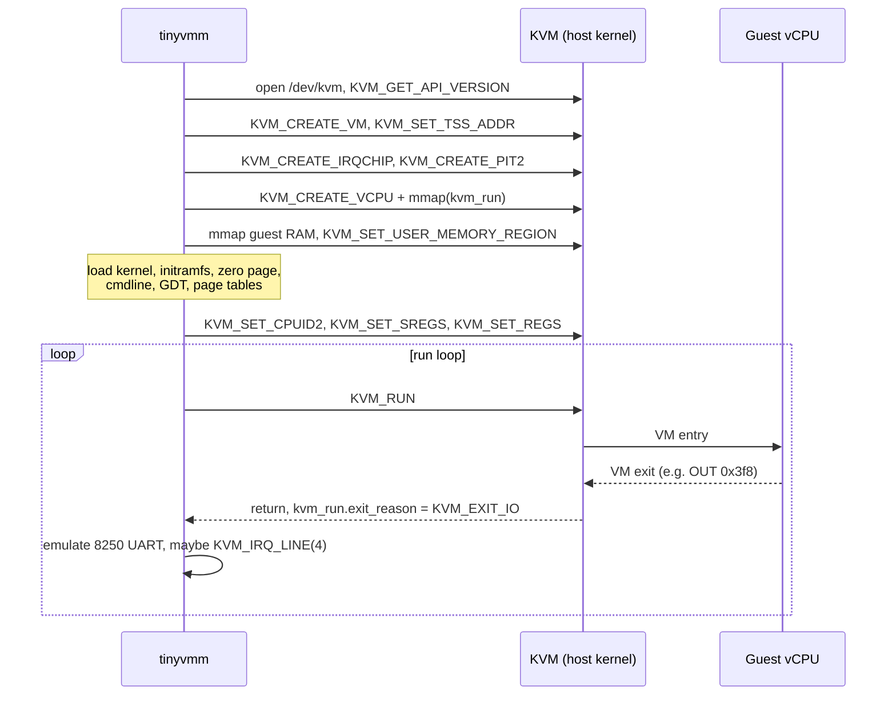
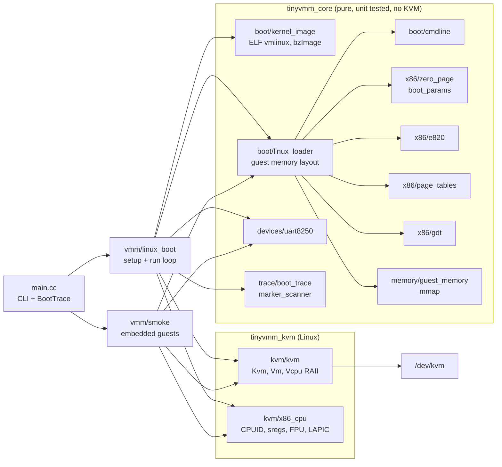

# tinyvmm

A minimal KVM virtual machine monitor in C++20 that boots a Linux kernel and shows where each millisecond of VM
startup goes.

tinyvmm is in the same family as Firecracker and kvmtool, but much smaller: one vCPU, a serial console, and a
boot-latency tracer. It is written to make the KVM API and the x86 Linux boot protocol easy to read, and to be a
base for experiments on VM startup time (prefaulting, snapshots, virtio devices).

> **Status:** milestone 1. Unit tests and the loader are verified locally. The KVM paths have not been run on
> real hardware by me yet; CI is set up to run them on x86_64 runners with `/dev/kvm`. See
> [Verified vs untested](#verified-vs-untested).

## How a VMM works

KVM turns the Linux kernel into a hypervisor. A VMM is the userspace process that uses KVM through `ioctl`s on
three kinds of file descriptors: the system (`/dev/kvm`), a VM, and each vCPU. The CPU runs guest code directly;
when the guest does something the hardware cannot handle by itself (port I/O, MMIO to an unbacked address, a
shutdown), `KVM_RUN` returns to the VMM with an exit reason, the VMM emulates the device, and calls `KVM_RUN` again.



## Architecture



Everything that decides what the guest sees at reset (memory layout, `boot_params`, page tables, segment
descriptors, command line, UART behavior) lives in the pure library and is unit tested without KVM. The KVM layer
is thin RAII over file descriptors and `mmap`, with errors returned as `Result<T>` instead of exceptions.

## Boot phases

`tinyvmm boot` prints a table like this (the numbers come from your run, the table shape is fixed):

```
phase                since_start_ms     delta_ms
vmm_start                         ...          ...
kvm_ready                         ...          ...
memory_mapped                     ...          ...
kernel_loaded                     ...          ...
first_vcpu_entry                  ...          ...
first_serial_byte                 ...          ...
init_marker                       ...          ...
```

| Phase | What happens before it | What usually dominates |
|---|---|---|
| `vmm_start` | process start, `main` entered | (reference point) |
| `kvm_ready` | open `/dev/kvm`, create VM, in-kernel irqchip, PIT, vCPU | host KVM work, small |
| `memory_mapped` | `mmap` guest RAM, register memory slot | tiny when lazy; grows with `--prefault` |
| `kernel_loaded` | read + parse kernel and initramfs, copy into guest RAM, write zero page, cmdline, tables | file I/O and page faults on first touch of guest RAM |
| `first_vcpu_entry` | CPUID, segment and control registers, FPU, LAPIC | small |
| `first_serial_byte` | guest kernel runs until the 8250 console registers and flushes the printk buffer | kernel decompression (bzImage only), early setup |
| `init_marker` | rest of kernel init, unpack initramfs, run `/init`, `/init` prints the marker | device probing, console output (one VM exit per byte) |

The run also prints VM exit counts by port, which shows how much of the boot is spent on serial output.

## Quickstart (Linux host with KVM)

Requirements: x86_64 Linux, read/write access to `/dev/kvm`, CMake >= 3.24, a C++20 compiler (GCC 12+ or Clang 15+),
Ninja (optional), `cpio` and a static libc for the test initramfs.

```bash
cmake -S . -B build -G Ninja
cmake --build build
ctest --test-dir build --output-on-failure

./build/tinyvmm smoke --mode real     # 16-bit guest prints through the UART and halts
./build/tinyvmm smoke --mode long     # same in 64-bit mode with tinyvmm's GDT and page tables

scripts/fetch-kernel.sh artifacts     # Firecracker CI vmlinux 5.10 (no ACPI), checksum verified
scripts/make-initramfs.sh artifacts   # /init prints TINYVMM_INIT_OK and reboots

./build/tinyvmm boot --kernel artifacts/vmlinux --initrd artifacts/initramfs.cpio \
    --mem 256 --exit-on-marker --timeout 30 --trace-json trace.json
```

Useful flags: `--append quiet` (less console output), `--prefault` (populate guest RAM up front),
`--cmdline "..."` (replace the default command line), `--dry-run` (load everything into guest memory without
KVM and print the layout).

### macOS or a machine without KVM

The pure library and the unit tests build in a Linux container, and the loader can be exercised on a real kernel:

```bash
scripts/docker-test.sh                       # build + unit tests in ubuntu:24.04 (native arch)
scripts/docker-test.sh linux/amd64           # same for x86_64 under emulation
docker run --rm -v "$PWD:/src" -w /src tinyvmm-dev \
    ./build-docker/tinyvmm boot --kernel artifacts/vmlinux --dry-run
```

## Verified vs untested

| Item | State | How |
|---|---|---|
| Unit tests (70 tests: zero page, e820, cmdline, UART, page tables, GDT, kernel parsing, loader, tracer) | **Verified** | pass in Ubuntu 24.04 containers on aarch64 and on x86_64 (emulated), GCC 13, `-Werror` |
| Build on aarch64 Linux (KVM boot path compiled out) | **Verified** | same container |
| ELF vmlinux loader on a real kernel | **Verified (no KVM)** | `--dry-run` on Firecracker CI `vmlinux-5.10.225-no-acpi`: segments, entry `0x1000000`, e820, zero page, page tables |
| Smoke guest machine code | **Verified (emulator only)** | bytes executed in the Unicorn CPU emulator in 16-bit and 64-bit modes; output matched |
| Smoke guests under KVM (`smoke --mode real/long`) | **Untested** | no `/dev/kvm` on the development machine (Apple silicon); runs in CI on `ubuntu-latest` |
| Linux boot to `/init` under KVM, serial console, latency table | **Untested** | implemented; CI job `linux-boot` is marked experimental (`continue-on-error`) until a green run |
| bzImage boot | **Untested** | parser and loader tested only with synthetic headers; never booted |
| Boot latency numbers | **None published** | no numbers are quoted here until they come from a real run |

## Roadmap

- [x] **M1: boot skeleton.** RAII KVM wrappers, guest memory, real/long-mode smoke guests, ELF vmlinux and bzImage
  loading via the 64-bit boot protocol, 8250 UART on `0x3f8` with IRQ 4, boot-latency tracer, unit tests, CI.
  (Linux boot under KVM still to be confirmed in CI, see above.)
- [ ] **M2: platform tables.** MP table (then minimal ACPI) so Linux uses the IOAPIC; boot MSRs; CPUID topology.
- [ ] **M3: virtio-mmio.** virtio console and virtio-blk on the MMIO transport, devices declared on the command line
  (`virtio_mmio.device=`), irqfd/ioeventfd instead of exits to userspace.
- [ ] **M4: networking.** virtio-net backed by a TAP device, then vhost-net to move the data path into the host kernel.
- [ ] **M5: memory experiments.** lazy faulting vs `MAP_POPULATE` vs hugepages vs pre-touched snapshots, measured
  per phase.
- [ ] **M6: snapshot/restore.** save vCPU, irqchip, PIT and memory; restore into a fresh VM and compare
  time-to-init against a cold boot.
- [ ] **M7: multiple vCPUs.** one thread per vCPU, AP startup through INIT/SIPI.
- [ ] **M8: comparison.** same kernel and initramfs on QEMU `microvm` and Firecracker, same phase markers.
- [ ] **M9: aarch64.** `KVM_ARM_VCPU_INIT`, device tree, PL011 UART, arm64 `Image` loading.

## What I learned

- **Order of vCPU setup matters.** KVM validates `EFER.LME` against the guest's CPUID, so `KVM_SET_CPUID2` has to
  come before `KVM_SET_SREGS`, or entering long mode fails with `EINVAL`.
- **An in-kernel irqchip changes the run loop.** With `KVM_CREATE_IRQCHIP`, `HLT` is handled in the host kernel and
  never returns to the VMM, so "stop when the guest halts" no longer works; the VMM needs explicit stop conditions.
  `kvm_run->immediate_exit` is the race-free way to make a timeout signal stop `KVM_RUN`.
- **A serial port is a latency source.** Every byte the guest prints is a port write, which is a full VM exit to
  userspace. Console verbosity therefore shows up directly in the boot time, which is why fast-boot setups use
  `quiet` or a paravirtual console.
- **Device emulation has to match what drivers probe, not just what they use.** Linux's 8250 driver checks loopback
  (`MSR` must mirror `MCR`), FIFO bits in `IIR`, and whether the THRE interrupt re-asserts when re-enabled
  (`UART_BUG_THRE`). Getting these wrong silently changes the driver's mode instead of failing.
- **vmlinux vs bzImage.** An ELF vmlinux has no setup header, so the VMM fills in the fields the kernel reads; its
  `e_entry` is a physical address (`phys_startup_64`). A bzImage carries its own header, and its decompressor
  needs `pref_address + init_size` bytes of RAM, more than the file size suggests.
- **Unknown hardware should look absent.** Returning `0xff` for unmapped ports makes the kernel's probes fail fast
  instead of waiting for timeouts.

## Repository layout

```
src/common     Result type, RAII fd/mmap, file reading
src/memory     guest RAM
src/kvm        KVM wrappers and x86 vCPU setup
src/x86        GDT, page tables, e820, boot_params
src/boot       kernel image parsing, command line, Linux loader
src/devices    8250 UART
src/trace      boot tracer, marker matcher
src/vmm        smoke guests and Linux boot run loop
guest/         /init for the test initramfs
scripts/       kernel fetch, initramfs build, docker test runner
docs/DESIGN.md design notes, memory map, exit handling
```

## License

MIT, see [LICENSE](LICENSE).
